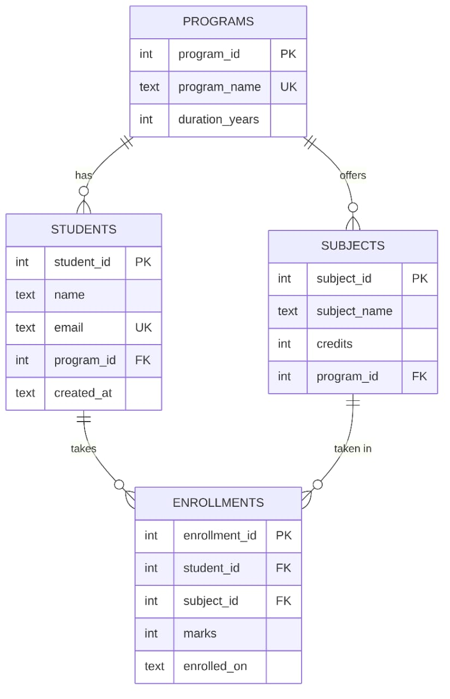

# Student Management System (REST API + SQLite Database)

DBMS Project – Node.js, Express.js and a relational database (SQLite, in 3NF).

The earlier in-memory array has been replaced by a real database with 4 related tables,
a view, a trigger, indexes and constraints.

## Project Structure

```
student-management-api/
├── app.js                    # server + error handling
├── package.json
├── db/
│   ├── students.db           # ready-made database (already filled with sample data)
│   ├── schema.sql            # CREATE TABLE / INDEX / TRIGGER / VIEW
│   ├── seed.sql              # sample data
│   ├── queries.sql           # 12 practical SQL queries (joins, group by, subquery...)
│   └── database.js           # DB connection
├── models/                   # all SQL lives here
├── routes/                   # students, enrollments, catalog, reports
├── middleware/logger.js
├── utils/httpError.js
└── scripts/resetDb.js        # npm run db:reset
```

## Setup (VS Code)

```
npm install
npm start
```

Server: http://localhost:3000. The database file `db/students.db` is used automatically.
To restore the original sample data at any time: `npm run db:reset`.
(If `db/students.db` is deleted, it is re-created on the next start.)

`better-sqlite3` needs no separate database server – no MySQL / XAMPP installation required.
Open `db/students.db` in **DB Browser for SQLite** to see tables and run `db/queries.sql`.

## ER Diagram



## Database Design

| Table | Purpose | Keys |
|-------|---------|------|
| programs | BCA, BTech, MCA, MTech | PK `program_id`, UNIQUE `program_name` |
| students | student details | PK `student_id`, FK → programs, UNIQUE `email` |
| subjects | subjects of each program | PK `subject_id`, FK → programs |
| enrollments | Student ↔ Subject (many-to-many) | PK `enrollment_id`, FK → students (CASCADE), FK → subjects (CASCADE), UNIQUE (student, subject) |

**Normalization (3NF):** the old `course` text was repeated for every student. It is now stored once
in `programs` and referenced by `program_id` (removes redundancy and update anomalies).
Marks depend on the (student, subject) pair, so they sit in the junction table `enrollments`.

**Other DBMS features used**
- Constraints: PRIMARY KEY, FOREIGN KEY, UNIQUE, NOT NULL, CHECK (marks 0–100, credits 1–6)
- `ON DELETE CASCADE` – deleting a student deletes his enrollments
- `ON DELETE RESTRICT` – a program with students cannot be deleted
- Trigger `trg_enrollment_same_program` – a student can only enrol in subjects of his own program
- View `vw_student_results` – 4-table join with grade calculation
- Indexes on foreign-key columns

## API Endpoints

| Method | Endpoint | Description |
|--------|----------|-------------|
| GET | /students | All students (optional `?course=BCA`) |
| GET | /students/:id | One student |
| GET | /students/:id/results | Marks and grades of a student |
| POST | /students | Create student |
| PUT | /students/:id | Update student |
| DELETE | /students/:id | Delete student |
| GET | /programs | Programs with student count |
| GET | /subjects | Subjects (optional `?program=BCA`) |
| GET | /enrollments | All enrollments (from the view) |
| POST | /enrollments | Enrol a student in a subject |
| PUT | /enrollments/:id | Update marks |
| DELETE | /enrollments/:id | Remove an enrollment |
| GET | /reports/program-summary | Students & average marks per program |
| GET | /reports/toppers | Top 3 students by average marks |

## Testing with Postman

**POST** `http://localhost:3000/students`
```json
{ "name": "Sneha", "course": "MCA", "email": "sneha@example.com" }
```
(`email` is optional; `course` must be an existing program: BCA, BTech, MCA, MTech.)

**PUT** `http://localhost:3000/students/1`
```json
{ "course": "BCA" }
```

**POST** `http://localhost:3000/enrollments`
```json
{ "student_id": 1, "subject_id": 1, "marks": 85 }
```
(Already enrolled → 409. Subject of another program → 400, rejected by the trigger.)

**PUT** `http://localhost:3000/enrollments/1`
```json
{ "marks": 91 }
```

## Status Codes

200 OK · 201 Created · 400 Bad Request (invalid id / missing field / constraint or trigger failed) ·
404 Not Found · 409 Conflict (duplicate email / enrollment) · 500 Internal Server Error
